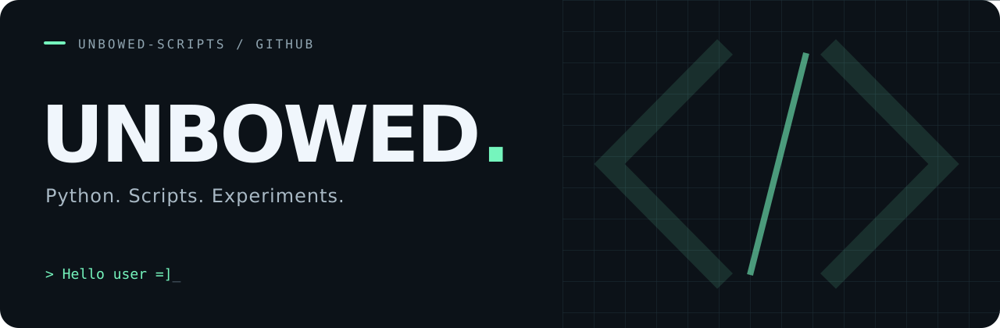

  

  <a href="https://github.com/unbowed-scripts?tab=repositories">Projects</a>
  &nbsp; / &nbsp;
  <a href="https://t.me/byteix">Telegram</a>
  &nbsp; / &nbsp;
  Discord: <code>@byteixys</code>

 

### 01 / Hello user =]

Welcome to my corner of GitHub — a place for Python scripts and experiments.

### 02 / Featured project

**[Pin-generator ↗](https://github.com/unbowed-scripts/Pin-generator)**

A lightweight Python password-generation experiment that works without the `random` library.

`Python` &nbsp; `CLI` &nbsp; `Experimental`

### 03 / Find me elsewhere

[Telegram @byteix ↗](https://t.me/byteix) &nbsp; · &nbsp; Discord: **@byteixys**

---

UNBOWED &nbsp; / &nbsp; SCRIPTS & EXPERIMENTS

